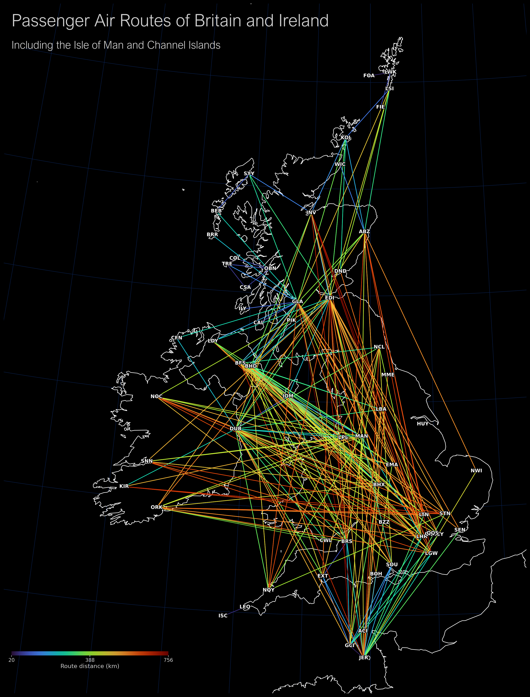

# British Isles passenger routes



`map_routes.py` creates `british_isles_air_routes.png`: white coastlines for the British Isles and nearby land visible in the map frame on black, with passenger routes between airports inside the British Isles. Routes follow spherical great-circle arcs, use a uniform 1-point line width, and are coloured by dataset distance (blue to red), with a horizontal distance scale beneath the title. Airport markers are labelled with their IATA codes centered directly on the airport coordinates. The map uses British National Grid (OSGB36 / Transverse Mercator) with dark-blue latitude and longitude lines beneath the land fill.

Run from this directory with [uv](https://docs.astral.sh/uv/):

```powershell
uv run map_routes.py
```

On first run the script fetches the route data and Natural Earth 1:10m country boundaries into `data/`. The source route list is directional, so both directions can appear when listed; destinations outside the included islands are filtered out. Jet/propeller classification is not available in the route records, so routes use one shared colour scale.

The console output also lists the three shortest and three longest included directional routes, with their dataset distances.

Route data: [Jonty/airline-route-data](https://github.com/Jonty/airline-route-data). Coastline boundaries: [Natural Earth](https://www.naturalearthdata.com/downloads/10m-cultural-vectors/10m-admin-0-countries/).
